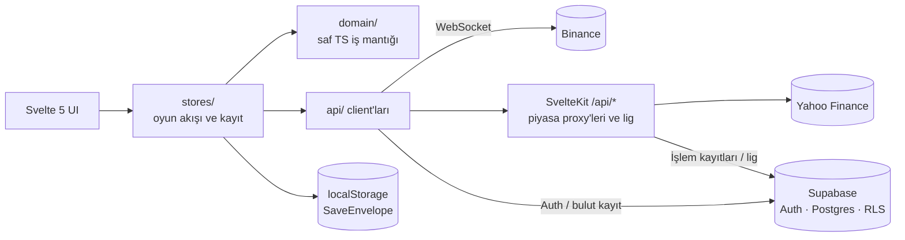

# Miras Oyunu

[](https://github.com/rudukan/miras/actions/workflows/ci.yml)

**🎮 Canlı: [miras-one.vercel.app](https://miras-one.vercel.app)**

Hiç tanımadığın büyük amcandan 1.000.000 USD miras kaldı. Türkiye'nin makro koşullarında — kur, enflasyon, BIST, ABD borsası, kripto, altın — bu parayı işletiyorsun. Bloomberg-terminali estetiğinde, tarayıcıda çalışan bir finansal simülasyon oyunu. Kripto fiyatları canlı; diğer kaynaklar gecikmeli veya türetilmiş veri içerebilir.

> **EN summary:** A browser-based financial simulation game: manage a $1M inheritance using a mix of live, delayed, and derived market data. Built with SvelteKit 2, Svelte 5, and TypeScript, with a framework-independent domain layer, Supabase accounts and cloud saves, and server-stamped weekly league trades. Unit tests, synthetic-scenario simulations, and Playwright E2E tests run in CI on main pushes and pull requests.

## Mevcut kapsam

- Misafir, Google ve e-posta/şifre ile giriş; kullanıcı profili ve bulut kayıt senkronu.
- Canlı seans, portföy, al/sat, TL mevduat ve basitleştirilmiş emlak/kira mekanikleri.
- Haftalık lig: pazartesi başlangıcı, cuma kapanış kilidi ve sunucunun fiyatını damgaladığı işlemler. Skor, işlem geçmişinin sunucuda yeniden oynatılmasıyla hesaplanır.
- Kapalı piyasa veya bayat fiyat durumunda, ilk uygun taze fiyatı bekleyen emirler.

## Piyasa verisi

- **Kripto:** Binance WebSocket; bağlantı kesilirse snapshot fallback ve son bilinen fiyat kullanılır.
- **BIST:** ücretsiz kaynak nedeniyle yaklaşık 15 dakika gecikmeli; istemci 20 saniyede bir sorgular. Sunucudaki 5 saniyelik cache, kaynağın veri gecikmesinden ayrı bir süredir.
- **ABD hisseleri ve döviz:** piyasa kaynağının fiyat/zaman damgaları kullanılır; tüm semboller için anlık veri garantisi verilmez.
- **Altın/gümüş:** ons cinsinden vadeli fiyatlardan gram ve TL değerine çevrilir; doğrudan spot fiyat değildir.

Uygulamadaki [Veri Hakkında](src/lib/components/ui/DataInfoModal.svelte) açıklaması kaynak, fiyat tazeliği ve operatif kur ayrımını gösterir.

## Mühendislik kararları

- **Para birimi ve işlem yuvarlaması** — [`Money`](src/lib/domain/money.ts), tutarı ve para birimini birlikte taşır; içeride JavaScript `number` kullanır. Alış bedeli yukarı, satış hasılatı aşağı sente yuvarlanır; böylece küçük işlemleri bölerek yuvarlamadan kazanç üretme yolu kapatılır. Bu model, sabit noktalı veya ondalık aritmetik garantisi vermez.
- **Eşikli mühürlü kur** — canlı USD/TRY her saniye oynar; net servetin gürültüyle titrememesi için kur günde bir "mühürlenir", ama mühürden %0.75+ sapan *gerçek* hareket aynı gün yeniden mühürlenir ([`liveGameStore`](src/lib/stores/liveGameStore.svelte.ts)). Gürültü bastırma ile doğruluk arasında bilinçli bir orta yol.
- **1000-seed senaryo simülasyonu** — VASİYET SEFERİ'nin 365 günlük sentetik senaryo modelinde nakitte bekleme, temkinli, dengeli ve agresif stratejiler karşılaştırılır. %30–70 kazanma bandı yalnız dengeli strateji için doğrulanır; diğer stratejilerin ayrı beklentileri vardır. Bu test, canlı piyasanın veya haftalık ligin dengeli olduğunu kanıtlamaz ([testler](tests/balance/winnability.test.ts)).
- **Hibrit veri akışı** — WebSocket, periyodik sorgulama ve fallback kullanılır. Son bilinen fiyatın gösterilmesi, yeni piyasa verisinin geldiği anlamına gelmez; işlem akışı fiyat tazeliğini ayrıca kontrol eder.
- **DST-duyarlı borsa takvimi** — NYSE ve BIST seans saatleri, ABD yaz saati geçişleri ve 2026 tatil listeleriyle modellenir ([takvim](src/lib/domain/calendar/)).
- **ABD hisse araması** — Yahoo arama API'si üzerinden NYSE/NASDAQ sembolleri aranır; arama ve fiyatlama, veri kaynağının kapsamı ve erişilebilirliğiyle sınırlıdır.

## Mimari



- `src/lib/domain/` — çekirdek iş mantığı: framework'süz, saf TypeScript, her modül tek sorumlu, testleri yanı başında. UI olmadan da çalışır/test edilir.
- `src/lib/stores/` — oyun durumu, sistemler arası koordinasyon ve yerel/bulut kayıt uzlaşması.
- `src/routes/api/` — piyasa proxy'leri, sunucu damgalı işlemler, lig kapanışı ve hesap endpoint'leri.
- `supabase/migrations/` — kullanıcılar, kayıtlar, telemetri ve lig için şema ve RLS kuralları.
- CI, `main` push'larında ve pull request'lerde çalışır. Vercel, GitHub entegrasyonuyla deploy alır; CI iş akışında ayrı bir deploy adımı yoktur.

## Test & doğrulama

- **Vitest:** domain, store ve API testleri; 1000-seed sentetik senaryo simülasyonu da bu koşuya dahildir. Güncel test sayısı `npm run test` çıktısındadır.
- **Statik kontrol ve build:** `svelte-check` ile TypeScript/Svelte kontrolü, ardından üretim build'i.
- **Playwright E2E:** al/sat ve kayıt kalıcılığı, giriş/kayıt/şifre kurtarma, misafir/offline akışları, grafikler ve bekleyen emir senaryoları. Yerel Supabase ve mock piyasa verisiyle çalışır; gerçek piyasa sağlayıcılarının erişilebilirliğini test etmez.
- [CI](https://github.com/rudukan/miras/actions), test/check/build ve E2E işlerini çalıştırır. Testlerin geçmesi, bütün oyun stratejilerinin dengeli veya bütün sayısal uç durumların hatasız olduğu garantisi değildir.

## Geliştirme süreci

Bu proje AI destekli ama mühendislik disipliniyle yürütülüyor: her önemli dilim önce **spec** ve **uygulama planına** dönüşür ([`docs/superpowers/`](docs/superpowers/)), uygulama **TDD** ile yapılır, kararlar ve gerekçeleri [`memory.md`](memory.md)'de yaşar. Tasarım kararlarının *neden*'i de kod kadar versiyonludur.

## Yol haritası (özet)

Hesap altyapısı ve haftalık lig kodda mevcut. Açık işler arasında sentetik senaryodaki agresif stratejinin kalibrasyonu, kullanıcı deneyi/oynanış değerlendirmesi ve diğer senaryo modları bulunuyor. Denge testindeki [bilinen sınırlama](tests/balance/winnability.test.ts) ile ayrıntılı plan ve durum notları için [`memory.md`](memory.md) dosyasına bak.

## Çalıştırma

```bash
npm ci
cp .env.example .env.local  # yerel yapılandırmayı tamamla
npm run dev     # http://localhost:5173
npm run test    # Vitest
npm run check   # svelte-check (TS strict)
npm run build   # üretim build'i
```

Playwright için Docker Desktop ve yerel Supabase gerekir: `npx supabase start` sonrasında `npm run e2e`. Test yardımcıları yerel adreslere sabitlenmiştir.

## Lisans & haklar

Kaynak kod, mühendislik yaklaşımını göstermek amacıyla **vitrin olarak** açıktır. "Miras Oyunu" adı, oyun tasarımı, içeriği ve görselleri üzerindeki **tüm haklar saklıdır** — kod ve içerik, yazılı izin olmadan kopyalanamaz, yayınlanamaz veya ticari amaçla kullanılamaz.

*Bu bir oyundur; hiçbir içeriği yatırım tavsiyesi değildir.*
